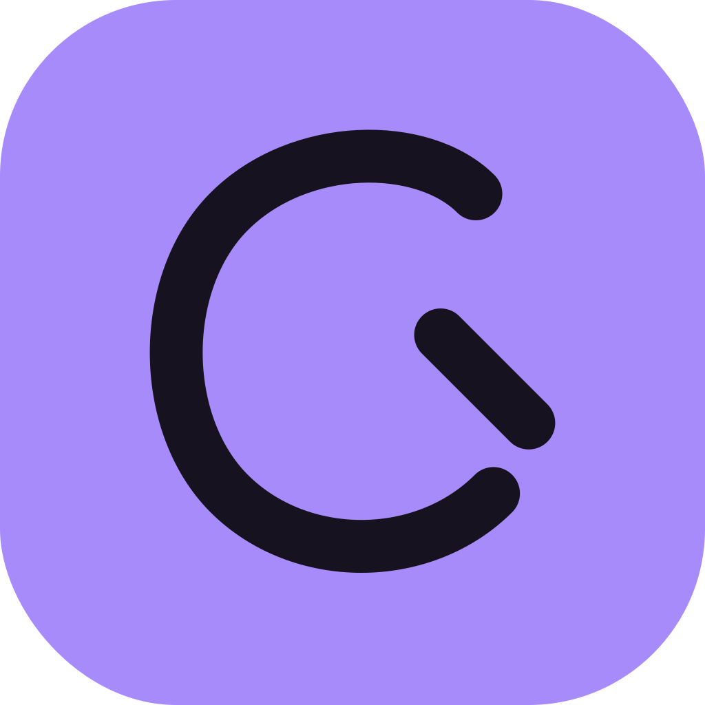
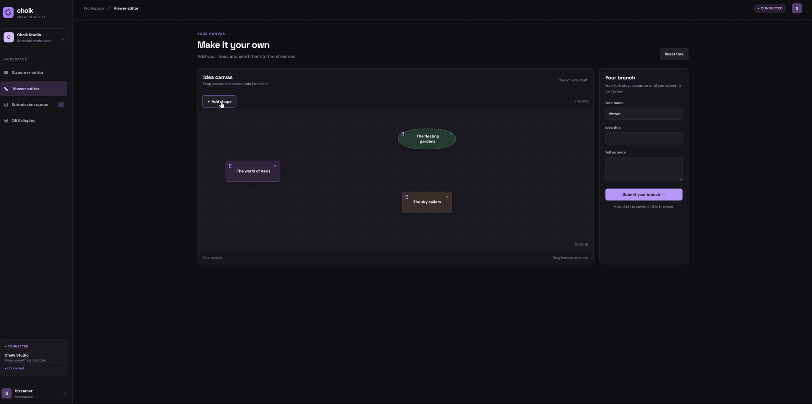
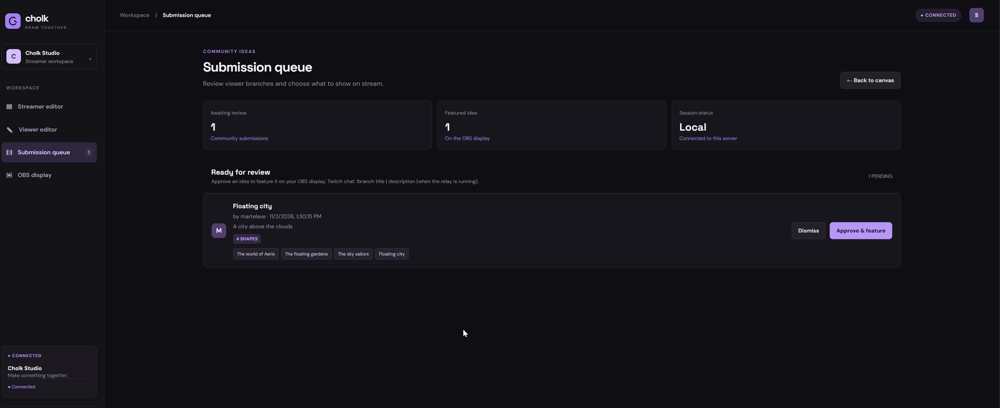
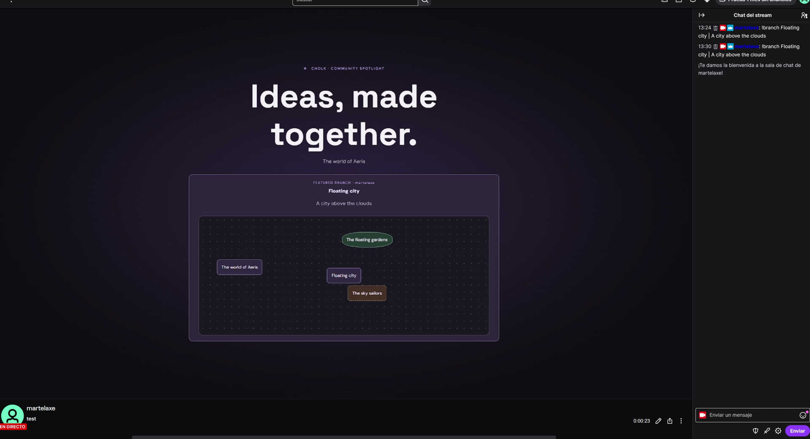

# Cholk

**A shared canvas for Twitch streamers and their communities.**

Cholk gives viewers a way to contribute ideas to what a streamer is creating. Streamers review submissions and choose what to feature on stream.

Built with OpenAI Codex for the Codex x TwitchCon Hackathon.



## How it works

1. The streamer creates a canvas with labeled shapes.
2. Viewers can contribute in two ways:
   - **Canvas:** Open a viewer link, edit an independent copy, and submit it through the website.
   - **Twitch chat:** Send a suggestion using `!branch Title | Description`. The relay adds it to a copy of the canvas.
3. The streamer approves or dismisses each submission.
4. Approved ideas appear in an OBS Browser Source.



We tested this flow with a real Twitch chat message and showed the approved result on a live Twitch broadcast.



## Run locally

Requires **Python 3.10 or newer**.

```bash
git clone https://github.com/Cholk-twitch/branchcast.git
cd branchcast
python3 server.py
```

On Windows, use `py server.py`.

Open [http://127.0.0.1:8000](http://127.0.0.1:8000) and keep the server running.

The browser that creates the session keeps the streamer access key. Use that same browser to edit the canvas and review submissions.

## Connect Twitch and OBS

1. Register a Twitch application and authorize a user token with the `user:read:chat` scope.
2. Install the Twitch relay dependency:
   ```bash
   python3 -m pip install -r requirements.txt
   ```
3. Start Cholk and copy the session ID from the browser URL.
4. Set `TWITCH_CLIENT_ID`, `TWITCH_USER_TOKEN`, `TWITCH_BROADCASTER_ID`, and `TWITCH_USER_ID` in your terminal.
5. Start the relay:
   ```bash
   python3 feasibility/twitch_bridge.py --session YOUR_SESSION_ID
   ```
6. In Cholk, open **OBS display** and copy the URL into an OBS **Browser Source**.

See [Twitch and OBS setup](TWITCH_SETUP.md) for details. Keep access tokens and client secrets private.

## Built with

- **OpenAI Codex** — development
- **Python and SQLite** — server and session storage
- **HTML, CSS, and JavaScript** — canvas and interface
- **Twitch EventSub** — chat messages
- **OBS Studio** — stream display

## Current scope

Cholk runs locally. Viewer links using `127.0.0.1` work on the computer running the server; public hosting is not included. Session data is saved in `branchcast.db`.

## Next steps

- Add freehand drawing.
- Explore AI-assisted conversion of sketches into editable diagrams.
- Give communities more ways to remix a canvas.
- Explore AI agents that can suggest ideas for streamer review.

The AI diagram converter in `feasibility/` is a separate experiment and is not connected to the main app.

## Tests

```bash
python3 -m unittest discover -s tests
```

## Repository

[github.com/Cholk-twitch/branchcast](https://github.com/Cholk-twitch/branchcast)
